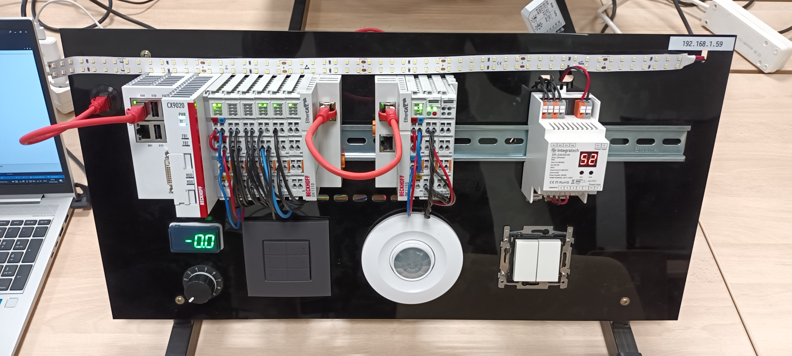

## The setup

The Digital Addressable Lighting Interface (DALI) is a communication protocol used in lighting control systems. It allows for digital communication between lighting fixtures, sensors, and control devices, enabling the creation of flexible and dynamic lighting systems. DALI is a two-way protocol, which means that control devices can both send and receive data to and from the lighting fixtures. This allows for individual control of each fixture, such as turning them on and off, dimming, and adjusting color temperature.

DALI is an open standard protocol, meaning that it is not owned by any single company and can be used by any lighting manufacturer. It has gained popularity in recent years due to its ability to reduce energy consumption and provide enhanced lighting control and automation in buildings.

The DALI protocol's data link layer is based on asynchronous serial communication. It consists of a start bit, 8 data bits, and a stop bit. It uses a differential Manchester encoding scheme and the data is transmitted using a two-wire bus, with each device connected in series.

The data link layer also includes mechanisms for addressing and controlling individual devices on the bus. Each DALI device has a unique 16-bit address that can be used to send commands to it. The devices are grouped into 16 logical channels, with up to 64 devices per channel. This allows for control of up to 1,024 devices in a single DALI network.

> Beckhoff Application Film: [Intelligent DALI lighting control system for highest energy efficiency](https://www.youtube.com/watch?v=pvF_gx5tHSY&list=PLO_MYxzSFFnYWlXqCy7Ek5_9-lSvw86cJ&index=13)

> BeckHoff Application Film: [Beckhoff manages 60K data points in Tower 185 at Frankfurt, consisting of DaLI and EnOcean communication.](https://www.youtube.com/watch?v=8wU_nKmCpQ0)

## Hardware

- DALI devices
  - Integratech SR-2303DIN, universele DALI dimmer
  - TRIDONIC DALI-XC, input controller (art. no. 28001716)
  - TRIDONIC DALI MSensor 02 5DPI 41w (art. no. 28000896)
  - TRIDONIC DALI USB 24138923

- PLC terminal: 
  - KL6811 DMX master terminal

## Preperations

- Lees de [documentatie van de dimmer](https://www.integratech.be/integratech-catalog/controller-dali-naar-pwm-rgbw-4x5a-din-rail/).
- Lees de [documentatie van de MSensor](https://www.tridonic.com/en/int/product/17380?tab=0).
- Lees de [documentatie van de schakelaars](https://www.tridonic.com/en/int/product/17786?tab=0).
- Lees de documentatie van de DALI configuratie [tool](https://www.tridonic.com/en/int/product/24138923?tab=0) en download [de software](https://www.tridonic.com/en/int/services/software/masterconfigurator)
- Raadpleeg de handleiding van de Beckhoff [KL6811 communication interface](https://download.beckhoff.com/download/Document/io/bus-terminals/kl6811en.pdf). Lees zeker de pagina’s:
  - Product overview => Introduction
  - Product overview => Technical data
  - Product overview => Basic function principles
  - Mounting and wiring => LED indicators
  - Configuration software KS2000
  - Appendix => DALI commands
- Lees volgende pagina’s over de DALI bibliotheek [Tc2_DALI](https://infosys.beckhoff.com/english.php?content=../content/1033/tcplclib_tc2_dali/index.html&id=)
  - Introduction
  - DALI
  - Programming => POU's => Low-Level commands => Base => FB_KL6811Communication and FB_DALIV2xSendDALICommand
  - Programming => POU's => High-Level commands => Part 102 => Power control => FB_DALIV2Dimmer2Switch
  - Programming => POU's => Third-party function blocks => Tridonic => FB_DALIV2SmartSPOT
  - Programming => DUTs => Structures => ST_KL6811InData, ST_KL6811OutData en ST_DALIV2CommandBuffer

## Goals

1.  Leg in je eigen woorden DALI uit. Hoe is het opgebouwd en wat kan je ermee?
2.  Beschrijf de aansluitingen van de KL6811.
3.  Beschrijf de ‘FB_KL6811Communication’ functieblok. Welke zijn de in- en uitgangen en waarvoor wordt deze gebruikt?
4.  Beschrijf de ‘ST_KL6811InData’ structure. Wat is de inhoud en waarvoor wordt deze gebruikt?
5.  Beschrijf de ‘ST_KL6811OutData’ structure. Wat is de inhoud en waarvoor wordt deze gebruikt?
6.  Beschrijf de ‘ST_DALIV2CommandBuffer’ structure. Wat is de inhoud en waarvoor wordt deze gebruikt?
7.  Beschrijf de aansluitingen en de werking van de Integratech universele DALI dimmer
8.  Beschrijf de aansluitingen en de werking van de TRIDONIC dali XC input controller en doel van de TRIDONIC DALI USB
9.  Beschrijf de aansluitingen en de werking van de TRIDONIC DALI MSensor 02

## Exercises

Programmeer de PLC en de DALI schakelaar de DALI dimmer kunnen besturen. Voor DALI te programmeren dien je de bibliotheek Tc3_DALI toe te voegen bij je References.

Programmatie (minimaal vereist om 60% te behalen)

1. Maak gebruik van de ‘FB_KL6811Communication ’ functieblok voor de communicatie met de KL6811. Koppel de juiste variabelen met de KL6811. Laat de status van deze functieblok zien in de visualisatie voor snelle foutopsporing. (10%)
2. Lees de DALI sensor uit met de FB_DALIV2SmartSPOT en toon alle waarden in de visualisatie. (15%)
3. Stuur de DALI dimmer aan met de FB_DALIV2Dimmer2Switch vanuit de visualisatie. De zes eerste inputs van de FB dienen bedienbaar te zijn. (15%)
4. Plaats de DALI schakelaar in "Mode D: GC-A" om de DALI dimmer aan te sturen. (20%)

Bijkomende programmatie (Percentage telt enkel indien minimale programmatie bereikt is).

5. Gebruik FB_DailyScheduler om de dimmer vanaf een bepaald uur naar een scene te gaan. (20%)
6. Schrijf alle nuttige data waarden van de DALI sensoren weg naar een CSV file. Deze moeten tegen een - via de visualisatie - instelbare sample rate toegevoegd worden aan de CSV en getoond worden in de visualisatie. (20%)

## Questions

For questions and support please place a comment in the pull request titled **Feedback**.

## Remarks

Take care of the setup. Afterwards return the setup to its original state and place it on top of the lab table in the same place. If you notice a defect, you must immediately inform the teacher.
